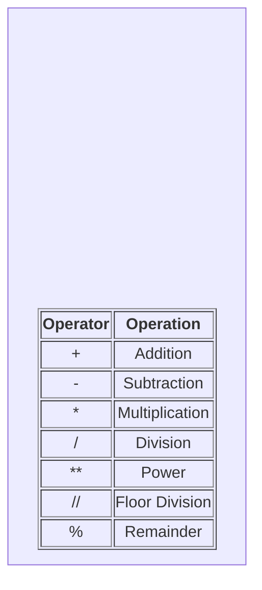
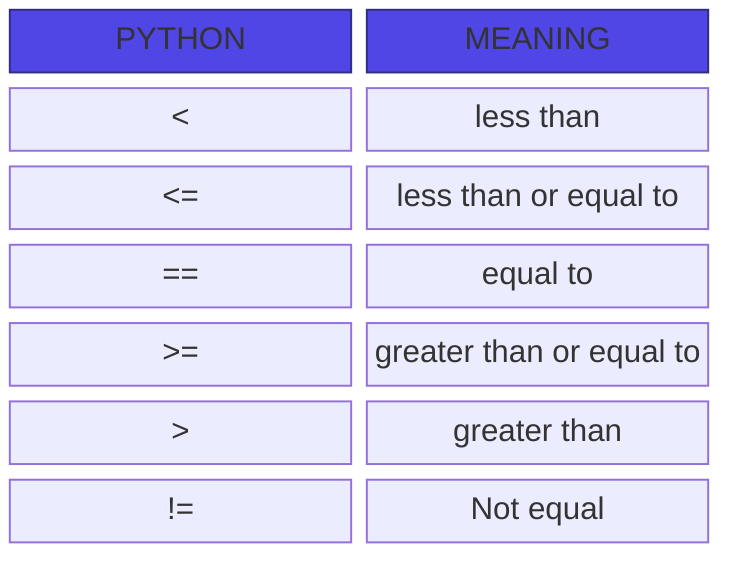
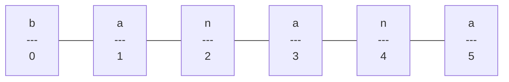

# Reserved words .

You cannot use reserved words as variable name / identifiers
- False: Represents the boollean false value.
- None: Represents the absence of a value or a null value.
- True: Represents the boolean true value.
- and: A logical operator that returns True if both statements are true.
- as: Used to create an alias when importing a module or in a with statement.
- assert: Used for debugging; tests if a condition is true and triggers an error if it is not
- async: Used to declare an asynchronous function or method.
- await: Pauses the execution of an asynchronous function until an awaited task completes.
- break: Immediately exits the current loop (for or while).
- class: Used to define a new user defined class (a blueprint for creating objects).
- continue: Skips the rest of the current loop iteration and moves directly to the next one.
- def: Used to define a new function.
- del: Deletes a reference to an object, such as a variable, list item, or dictionary key.
- elif: Short for "else if"; used in conditional statements to check multipel conditions sequentially.
- else: Defines a block of code to run if the if (or elif) condition is false, or if a loop completes without hitting a break.
- except: Catches and handles exceptions (errors) that occur within a try block.
- finally: Defines a block of code that will execute no matter what, even if an exception is raised in a try block.
- for: Used to create a loop that iterates over a sequence (like a list, tuple, or string).

- from: Used alongside import to import specific attributes or functions from a module.

- global: Declares that a variable inside a function refers to a variable defined at the top level of the script, rather than a local variable.

- if: Starts a conditional statement to execute code only if a specific condition evaluates to true.

- import: Used to bring an entire external module or library into your current script.

- in: Checks if a specific value is present within a sequence (like a list or string); also used in for loops.

- is: Tests for object identity, checking if two variables refer to the exact same object in memory.

- lambda: Used to create a small, anonymous (unnamed) function on a single line.

- nonlocal: Declares that a variable in a nested function refers to a variable in the nearest enclosing scope (excluding the global scope).

- not: A logical operator that reverses the boolean value of a statement.

- or: A logical operator that returns True if at least one of the statements is true.

- pass: A null statement that does nothing; used as a placeholder when syntax requires a statement but you have no code to execute yet.

- raise: Manually triggers an exception or error.

- return: Exits a function and optionally passes a value back to the caller.

- try: Starts a block of code to be tested for potential errors during execution.

- while: Creates a loop that continues executing its block of code as long as a specified condition remains true.

- with: Simplifies exception handling and resource management, commonly used for automatically closing files after opening them.

- yield: Pauses a function and returns a value like return, but saves the state to allow the function to be resumed later (creating a generator).  
 
 ## Condititonal steps
 ```python
 x = 5 
 if x < 10:
    print("smaller")
if x > 20:
    print("bigger")

print("Finis")
```
## Repeated Steps
- loops (repeated steps) have iteration variable that change each time through a loop.
```python
n = 5
while n>0:
    print(n)

print("blastoff!")
```
## Variables
- A variables is a named place in the memory where a programmer can store data and later retrive the data using the variable "name"
- Programmers get to choose the names of the variables
- You can change the contents of a variable in a later statement
```python
x=5
y=6
print(x+y)
```
## Numerical Expressions

### Operator Precedence Rules
Highest precedence rule to lowest precedence rule:
- Parentheses are always respected
- Exponentiation (raise to a power)
- Multiplication, Division, Floor Division, and Remainder
- Addition and Subtraction
- Left to right

## type function 
- In python variables, literals, and constants have a "type"
- python knows the difference between an integer number and a string 
- python knows what "type" everything is 
- some operations are prohibited 
- you cannot "add 1 " to a string 
- we can ask python what type something is by using the type() function
```python
type(eee)
>>> <class'str'>

type(1)
>>> <class'int'>
```
## several types of Numbers
- Numbers have two main types
- integers are whole numbers:
  -14, -2 ,0 ,1,100, 401233
- Floating point Numbers have decimla parts: -2.5, 0.0, 98.6, 14.0
- There are other number types -they are variations on float and integer
## Type conversions
- when you put an integer and floating point in an expression, the integer is implicitly converted to a float
- You can contol this with the build-iin function int() and float()
## Division
- Dividing integers and floating point numbers using the / operator always produces a floating point result.
```python
print(10/2)
>>> 5.0
print(99.0./100.0)
>>> 0.99

```
## Floor Division
- Division using // operator always produces a result that is the floor of the division-meaninig the result is rounded down to the nearest integer value.
```python
print(10//2)
>>> 5.0
print(9//2)
>>> 4
```
## string Conversions
- you can also use int() and float() ato convert between strings and integers
- you will get an error if the string does not contain numeric characters
 
 ## User Input
- we can instruct python to pause and read data from the user using the input() function 
- The input() fuction returns a string
``` python
name=input("who are you?")
print("welcome", name)
```
## Comments in Python
- Anything after a # is ignored by python 
- why comment?
 - - Describe what is going to happen in a sequence of code
 - - Document who wrote the code or other ancilary information
 - - Turn off a line of code - perhaps temporarily
 
 ```python
 # Get the name of the file and open it
 name= input("Enter file:")
 handle = open(name, "r")

 # Count word Frequency
 counts=dict()
 for line in handle:
    words = line.split()
    for word in words:
        counts[word] = counts.get(word,0) + 1

# Find the most common word
bigcount = None
bigword = None
for word,count in counts.items():
    if bigcount in none or count > bigcount:
        bigword = word
        bigcount = count


# All done
print(bigword, bigcount)
```
# Conditional Execution
- Boolean expressions ask a qusetion and produce a YES or NO result which we use to control program flow
- Boolean expressions using comparison operators evaluate to TRUE / FALSE or YES/NO
- Comparison operators look at variables but do not change the variables

## Indentation 
Visualizing the Block (Indentation)
In Python, you do not "close" an if statement with an endif or a closing bracket . The block is visually and logically defined entirely by whitespace (typically 4 spaces).

- Code aligned at the same indentation level belongs to the same block.

- Moving back to the left (dedenting) signals the end of that specific decision block.

To see exactly how a multi-way and nested block evaluates path-by-path, you can step through this interactive visualization:

## One-Way Decisions
- An if statement with no alternative. If the condition is True, the indented block executes. If False, the program skips it entirely.
```python
x = 10
if x > 5:
    print("x is greater than 5") 
# Execution continues here regardless

```
## Two-Way Decisions (with else)
- An if-else statement provides two strict paths. If the condition is True, the first block executes. If False, the else block executes. One of the two paths is guaranteed to run.
``` python
age = 16
if age >= 18:
    print("Eligible to vote")
else:
    print("Not eligible to vote")
```
## Multi-Way Decisions (elif)
- Used when you have more than two mutually exclusive conditions. Python checks each condition from top to bottom. As soon as one evaluates to True, its block executes, and the rest of the chain is skipped.
```python
score = 85
if score >= 90:
    print("Grade: A")
elif score >= 80:     # Checks this only if the first 'if' is False
    print("Grade: B")
elif score >= 70:     # Checks this only if the 'elif' above is False
    print("Grade: C")
else:                 # Catch-all if everything above is False
    print("Grade: F")

```

## Nested Decisions
- Placing an if statement inside another if statement. This is used when a secondary condition should only be checked if the primary condition is already met.
```python
user_logged_in = True
is_admin = False

if user_logged_in:               # Primary decision
    print("Welcome back!")
    
    if is_admin:                 # Nested decision (indented further)
        print("Admin Dashboard Accessed")
    else:
        print("Standard User Dashboard")
```
## Python Functions
- There are two kinds of functions in python.
- Built-in functions that are provided as part of python - print(),input(),type(),float(),int()...
- functions that we define ourselves and then use
- we treeat function names as "new" reserved words (i.e., we avoid them as variable names )
## Function Definiiton
- In python a function is some reusable code that takes arguments(s) as input. does some computation, and then returns a result or results
- we define a function using the def reserved word
- we call/invoke the function by using the function name, parenteses, and arguments in an expenssion
 
 ## max function
 - A function is some stored code that we use. A function takes some input and produces an output.

 ```python
 big=max("Hello world")
 print(big)
 >>>W


 tiny = min("Hello world")
 print(tiny)
>>>' '
```
## Type conversions
- when you put an integer and floating point in an expession, the integer is implicitly converted to  a float
- you can control this with the build-in functions int() and float()

## string conversions
- you can also use int() and and float() to convert between strings and integers
- you will get an error if the string does not contain numeric characters

## Building our Own Function 
- we create a new function using the def keyword followed by optional parameters in parentheses
- we indent the body of the function
- This defines the function but does not execute the body of the function 

## Building our own Functions
- we create a new function using the def keyword followed by optional parameters in parentheses
- we indent the body of the function
- This defines the function but does not execute the body of the function


### Definitons and Uses
- once we have defined a function, we can call (or invoke) it as many times as we like
- This is the store and reuse pattern

## Arguments
- An argument is a value we pass into the function as its input when we call the function
- we use arguments so we can direct the function to do different kinds of work when we call it at different times
- we put the arguments in parentheses after the name of the function

## Parameters
A parameter is a variable which we use in the funciton definition. It is a "handle" that allows the code in the function to access the arguments for a particular function invocation.

## Return Values
often a function will take it arguments, do some computation, and return a value to be used as the value of the function call in the calling expression. The return keyword is used for this.

- A "fruitful" function is one that produces a result (or return value)
- The return statement ends the function execution and "sends back" the result of the function

### Multiple Parameters/ Arguments
- we can define more then one parameter in the function definition
- we simply add more arguments when we call the funciton
- we match the number and order of arguments and parameters

```python
def addtwo(a,b):
    added = a+b
    return added

x = addtwo(3, 5)
print(x)

>>> 8
```
## void (non-fruitfull) Functions
- when a function does not return a value, we call it a "void" function
- Functions that return values are "fruitfull" functions
- Void functions are "not frutiful"

### To funcition or not to function...
 - organize your code into "paragraphs" - capture a complete thought and name "name it"
- Don't repeat yourself - make it work once and then reuse it 
- If something gets to long or complex, break it up into logical chunks and put those chunks in functions
- make a library of common stuff that you do over and over - perhaps share this with your friends...

# Loops and Iteration
## Repeated Steps
Loops have iteration variables that change each time through a loop. often these iteration variables go through a sequence of numbers.
```python
n = 5
while n > 0 :
    print(n)
    n = n - 1
    print("Blastoff!")
    print(n)

```
## An Infinite loop
 ```python
 n=0
 while n>0:
    print("lather")
    print("rinse")
print("Dry off!")
```
## Breaking out of loop
- The break statement ends the current looop and jumps to the statement immediately following the loop
- It is like a loop test that can happen anywhere in the body of the loop
```python
while True:
    line = input(">")
    if line == "done":
        break
    print(line)
print("Done!")

```
## Finishing an Iteration with continue
  
- The continue statement ends the current iteration and jumps to the top of the loop and starts the next iteration
```python
while True:
    line = input(">")
    if line[0] == "#" :
        continue
    if line == "done":
        break
    print(line)
 print("Done!")
 ```

 ## Indefinite loop 
 - while loops are called "indefinite loops" because they keep going until a logical condition becomes False
 - The loops we have seen so far are pretty easy to examine to see if they will terminate or if they will be "infinite loops"
 - Sometimes it is a little harder to be sure if a loop will terminate

 ## Definite Loops
 - Quite often we have a list of items of the lines in a file effectively a finite set of things
 - we can write a loop to  run that loop once for each of the items in a set using the python for construct
 - These loops are called :definite loops" because they execute an exact number of times 
 - we say that "definite loops iterate through the members of a set"
 ```python 
 # A simple Definite loops
 for i in [5,4,3,2,1]:
    print(i)
  print("Blastoff!")


  # A Definite Loop with strings
  friends = ["Joseph","Glenn","Sally"]
  for friend in friends :
    print("happy new year:", friend)
  print("Done!")
 
 ```
## A Simple Definite loop 
Definite loops(for loops) having explicit iteration variables that change each time through a loop. These iteration variable move through the sequence or set 

## Looking at in...
- The iteration variable "iterates" through the sequence (ordered set)
- The block(body) of code is executed once for each value in the sequence
- The iteration variable moves through all of the values in the sequence
- The iteration variable "Iterates" through the sequence (ordered set)
- The block (body) of code is executed once for each values in the sequence
- The iteration variable moves through all of the values in the sequence 
```python
for i in [5,4,3,2,1]:
    print(i)
```
## Loop Idioms: What we do in loops
Note: Even though these examples are simples, the patterns apply to all kinds of loops

## Making "smart" loops
- The trick is "Knowing" something about the whole loop when you are stuck writting code that only sees one entry at a time 
- - -
- Set some variables to initial vlaues 
for thing in data;
- look for something or do something to each entry separately, updating a variable
- Look at the variables
## Finding the largest value
- We make a variable that contains the largest value we have seen so far. If the current number we are looking at is larger, it is the new largest value we have seen so far.
```python
largest_so_far = -1
print("Before", largest_so_far)
for the_num in [9,41,12,3,74,15]:
    if the_num > largest_so_far :
        largest_so_far = the_num
        print(largest_so_far, the_num)

print("After", largest_so_far)
```
# More Loop Patterns...
## Counting in a loop
- To count how many times we execute a loop, we introduce a counter variable that starts at 0 and we add one to it each time through the loop.
```python
zork = 0
print("Before", zork)
for thing in [9,41,12,3,74,15]:
    zork = zork + 1
    print(zork,thing)
print("After", zork)

```
## Summing in a loop 
- To add up a value we encounter in a loop, we introduce a sum variable that starts at 0 and we add the vlaue to the sum each time through the loop.
```python 
zork = 0
print("Before", zork)
for thing in [9,41,12,3,74,15]:
    zork = zork + thing
    print(zork, thing)
print("After", zork)
```
## Finding the Average in a loop 
- An average just combines the counting and sum patterns and divides when the loop is done.
``` python
count = 0
sum = 0
print("Before", count, sum)
for value in [9,41,12,3,74,15]:
    count = count + 1
    sum = sum + value
    print(count,sum,value)
  print("After", count, sum, sum / count)
```
## Filtering in a loop
- We use an if statement in the loop to catch / filter the values we are looking for.
```python
print("Before")
for value in [9,41,12,3,74,15]:
    if value > 20:
        print("Large number", value)
print("After")
```
## Search using a Boolean Variable
- If we just want to search and know if a value was found, we use a variable that starts at False and is set to True as soon as we find what we are looking for.
```python
found = False
print("Before", found)
for value in [9, 41, 12, 3, 74, 15]:
    if value == 3 :
        found = True
        print(found, value)
    print("After", found)

```
## Finding the smallest value 
- we still have a variable that is the smallest so far. The first time through the loop smallest is None, so we take the first value to be the smallest.(the none is a void value) 
```python
smallest = None
print("Before")
for value in [9, 41, 12, 3, 74, 15]:
    if smallest is None :
        smallest = value
    elif value < smallest :
        smallest = value
    print(smallest, value)
print("After", smallest)
```
## This is and is not operators
- Python has an is operator that can be used in logical expressions 
- Implies "is the same ass"
- Similar to, but stronger than ==
- is not also is a logical operator
```python
smallest = None
print("Before")
for value in [3, 41, 12, 9, 74, 15]:
    if smallest is None :
        smallest = value
        elif value < smallest :
            smallest = value
        print(smallest, value)

print("After", smallest)
```
# String
## String Data Type 
- A string is a sequence of characters
- A string literal uses quotes 'Hello' or "Hello"
- For strings, + means "concatenate"
- When a string contains numbers, it is still a string
- We can convert numbers in a string into a number using int()
## Reading and converting
- We prefer to read data in using strings and then parse and convert the data as we need 
- This gives us more control over error situations and/or bad user input 
- Input numbers must be converted from stings
```python 
name = input("Enter:")
print("name")
>>>Enter:chuck
>>>chuck
```
## Looking Inside Strings
- we can get at any single character in a string using an index specified in square brackets
- The index value must be an integer and starts at zero
- The index value can be an expression that is computed 

```python
fruit = "banana"
letter = fruit[1]
print(letter)
>>>a
x = 3
w = fruit[x - 1]
print(w)
>>> n
```
## A character Too Far
- you will get a python error if you attempt to index beyond the end of a string
- so be careful when constructing index values and slices
## Strings have length
- The built-in function len gives us the length of a string
```python 
fruit = "banana"
print(len(fruit))
>>> 6
```
# Len Function
- A function is some stored code that we use. A fucntion takes some input and produces an output.
```python
fruit = "banana"
x = len(fruit)
print(x)
>>> 6 
```
## Looping Through Strings
- Using a while statement, an iteration variable, and the len function, we can construct a loop to lool at each of the letters in a string individually
```python
fruit = "banana"
index = 0
while index < len(fruit):
    letter = fruit[index]
    print(index, letter)
    index = index + 1 
```
- A definite loop using a for statement is much more elegant 
- The iteration variable is completely taken care of by the for loop 
```python
fruit = "banana"
for letter in fruit:
    print(letter)


index = 0 
while index < len(fruit):
    letter = fruit[index]
    print(letter)
    index = index + 1
```
## Looping and Counting
- This is simple loop that loops through each letter in a string and counts the number of times the loop encounteres the 'a' character
```python 
word = "banana"
count = 0 
for letter in word :
    if letter == "a" :
        count = count + 1
print(count)
```
## Looking Deeper into in 
- The iteration variable "iterates" through the sequence (ordered set)
- The block (body) of code is executed once for each value in the sequence
- The iteration variable moves through all of the values in the sequence
```python
for letter in "banana":
    print(letter)
```
- The iteration variable "iterates" through the string and the block (body) of code is executed once for each value in the sequence

## Slicing strings
- we can also look at any continuous section of a string using a colon operator
- The second number is one beyond the end of the slice - "up to but not including"
- If the second number is beyond the end of the string, it stops at end 
```python 
s = "Monty python"
print(s[0:4])
>>>Mont


print(s[6:7])
>>>p

print(s[6:20])
>>>python
```
- > If we leave off the first number of the last numberof the slice, it is assumed to be the beginning or end of the string respectively
```python 
s = "Monty Python"
print(s[:2])
>>>Mo

print([8:])
>>>thon

print(s[:])
Monty Python
```
## String Concatenation 
- when the + operator is applied to string, it means "concatenation"

```python
a = "Hello"
b = a + "There"
print(b)
>>>HelloThere
 c = a + ' ' + "There"
 print(c)
 >>>hello There
```
 ## Using in as a Logical Operator 
 - The in keyword can also be used to check to see if one string is "in" another string
 - The in expression is a logical expression that returns True or False and can be used in an if statement 
 ```python
 fruit = "banana"
 "n" in fruit
 >>>True


 "m" in fruit
 >>>False


"nan" in fruit
>>>True


if "a" in fruit :
    print("Found it!")
>>>Found it!
```
## String Comparison
```python
if word == "banana":
    print("All right, bananas.")

if word < "banana":
    print("your word," + word + ", comes before banana.")
else word > "banana":
    print("your word," + word + ", comes after banana.")
else:
    print("All right, bananas.")


```
## String Library
- python has a number of string functions which are in the string library
- These functions are already built into every string - we invoke them by appending the function to the string variable
- These functions do not modify the original string, instead they return a new string that has been altered

```python
greet = "Hello Bob"
zap = greet.lower()
print(zap)
>>>hello bob

print(greet)
>>>Hello Bob

print("Hi There".lower())
>>>hi there
```

## String Library
```python
str.capitalize()
str.center(width[, fillchar])
str.endswith(suffix[, start[, end]])
str.find(sub[, start[, end]])
str.lstrip([chars])
str.replace(old, new[, count])
str.lower()
str.rstrip([chars])
str.strip([chars])
str.upper()
# many more library in python official website , learn it from there

```
## Searching a String 
- we use the find() function to search for a substring within another string 
- find() finds the first occurrence of the substring 
- If the substring is not found, find() retunrs -1
- - remember that string postiton starts at zero
```python 
fruit = "banana"
pos = fruit.find("na")
print(pos)
>>>2
aa = fruit.find("z")
print(aa)
>>>-1
```

## Making everything UPPER CASE
- you can make a copy of a string in lower case or upper case
- Often when we are searching for a string using find() we first convert the string to lower case so we can search as string regardless of case 
```python
greet = "Hello Bob"
nnn = greet.upper()
print(nnn)
>>>HELLO BOB

www = greet.lower()
print(www)
>>>hello bob
```
## Search and Replace
- The replace() function is like a "search and replace" operation in a word processor 
- It replaces all occurrences of the search string with the replacememnt string 
```python 
greet = "Hello Bob"
nstr = greet.replace("Bob", "Jane")
print(nstr)
>>>Hello Jane

nstr = greet.replace("o","X")
print(nstr)
>>>HellX BXb
```
## Stripping Whitespace
- Sometimes we want to take a string and remove whitespace at the beginning and/or end
- lstrip() and rstrip() remove whitespace at the left or right
- strip() removes both beginning and ending whitespace
```python
greet = "   Hello Bob   "
greet.lstrip()
>>>"Hello Bob  "


greet.rstrip()
>>>"    Hello Bob   "

greet.strip()
>>>"Hello Bob"
```
### Prefixes
```python
line = "please have a nice day"
line.startswith("please")
>>>True

line.startswith("P")
>>>False
```
### Parsing and Extracting
```python
data = "From stephen.marquard@uct.ac.za Sat Jan  5 09:14:16 2008"
atpos = data.find("@")
print(atpos)
>>>21

sppos = data.find(' ',atpos)
print(sppos)
>>>31 

host = data[atpos+1 : sppos]
print(host)
>>>uct.ac.za
```
# Reading Files
## File Processing
- A text file can be thought of as a sequence of lines
## Opening a File
- Before we can read the contents of the file, we must tell python which file we are going to work with and what we will be doing with the file 
- This is done with the open() function
- open() returns a "file handle"o - a variable used to perform operations on the file 
- Similar to "file -> open" in a word processor
## Using open()
- fhand = open('mbox.txt','r')
- handle = open(filename, mode)
- returns a handle use to manipulate the file
- filenames is a string
- mode is optional and should be 'r' if we are planning to read the file and 'w' if we are going to write to the file

## what is handle?
```python
fhand = open('mbox.txt')
print(fhand)
>>><_io.TextIOWrapper name='mbox.txt' mode='r' encoding='UTF-8'>
```
## The newline character
- we use special character called the "newline" to indicate when a line ends
- we represents it as \n in strings
- Newline is still one character - not two 

```python
stuff = "Hello\nworld!"
stuff
"Hello\nworld!"
print(stuff)
>>>Hello
>>>world!

stuff = "X\nY"
print(stuff)
>>>X
>>>Y
len(stuff)
>>>3
```
- A text file can be thought of as a sequence of line
- A text file has newlines at the end of each line

# Reading Files in python
## File handle as a Sequence
- A file handle open for read can be treated as a sequence of strings where each line in the file is a string in the sequence
- we can use thr for statement to iterate through a sequence
- remember - a sequence is an ordered set
```python
xfile = open('mbox.txt')
for cheese in xfile:
    print(cheese)

```
## counting lines in a file
- open a file read-only
- use a for loop to read each line 
- Count the lines and print out the number of lines
```python
fhand = open('mbox.txt')
count = 0
for line in fhand:
    count = count + 1
print('line count:', count)
```
## Reading the *whole* file
- we can read the whole file (newlines and all) into a single string 
```python 
fhand = open('mbox-short.txt')
inp = fhand.read()
print(len(inp))
>>>94626
# The result is just a sample example

print(inp[:20])
>>> Form stephen.marquar
```
## Searching Through a File 
- we can put an if statement in our for loop to only print lines that meet some criteria 
```python
fhand = open('mbox-short.txt')
for line in fhand:
    line = line.rstrip()
    if line.startwith('From:'):
    print(line)
```
- We can strip the whitespace form the right-hand side of the string using rstrip() form the string library 
- The newline is considered "white space" and is stripped 
## Skipping with continue
- we can conveniently skip a line by using the continue statement 
## Using in to select Lines
- we can look for a string anywhere in a line as our selection criteria 
```python 
fhand = open('mbox-short.txt')
for line in fhand:
    line = line.rstrip()
    if not '@uct.ac.za' in line :
        continue
    print(line)
```
## Prompt for file name
```python
fname = input('Enter the file name:  ')
fhand = open(fname)
for line in fhand:
    if line.startwith('subject:'):
        count = count + 1
print('There were', count, subject lines in'. fname)
```
## Bad file names 
```python
fname = input('Enter the file name: ')
try:
    fhand = open(fname)
execpt:
    print('File cannot be opened:', fname)
    quit()

count = 0
for line in fhand:
    if line.startwith('Subject:'):
        count = count + 1

  print(' There were', count, 'subject lines in ', fname)
  ```

# Python lists
## programming
* Algorithms: A set of rules or steps used to solve a problem
- Data Structures: A particlar way to orginizing data in a computer

## what is not a "collection" 
Most of our variavles have one value in them - when we put a new value in the variable, the old value is overwritten

```python
x=2
x=4
print(x)
```
## A list is a Kind of collection
- A collection allows us to put many values in a single "variable"
- A collection is a nice because we can carry all many values around in one convenient package
 ``` python
 friends= ["Joseph", "Glenn", "sally"]
 carryon= ["socks", "shirt", "perfume"]
 ```
 ### List constants
 - List constants are surrounded by square brackets and the elements in the list are separated by cammas
 - A list element can be any python object-even another list
 - A list cam be empty
 ## looking inside list
 just like strinds , we can get at any single element in a list using an index specified in square brackets

```mermaid
graph TD
    X[Joseph] ~~~ n1(0)
    Y[Glenn] ~~~ n2(1)
    Z[Sally] ~~~ n3(2)

 ```
 ``` python
 friends = ["Joseph", "Glenn","Sally"]
 print(friends[1])

>>>>>Glenn
```
## Lists are Mutable
- Strings are "immutable" - we cannot change the contents of a string , we must make a new string to make any changes
- Lists are "mutable" , we can change an element of a list using the index operator
```python
fruit = "Banana"
fruit[0]="b"
>>> traceback
x=fruit.lower()
print(x)
>>> banana
lotto = [2,14,26,41,63]
print (lotto)
>>>[2,14,26,41,63]
lotto[2]=28
print(lotto)
>>>[2,14,28,41,63]
```   

  ## How Long is a list?
  - The len() function takes a list as a parameter and returns the number of elements in the list
  - Actually len() tells us the number of elements of any set or sequence (such as a strint...)
 
  ```python
  greet="hello Bob"
  print(len(greet))
  >>>9 
  x = [1,2, "joe", 99]
  print(len(x))
  >>>4
  ```
 ## Using the range function
 - The range function returns a list of numbers that range from zero to one less than the parameter
 - we can construct an index loop using for and an integer iterator
 ```python
 print(range(4))
 >>>[0,1,2,3]
 
 friends=["Joseph", "Glenn", "Sally"]
 print(len(friends))
 >>>3
 
 print(range(len(firends)))
 >>>[0,1,2,]
 ```
 ## Concatenating lists using '+'
 - We can create a new list by adding two existing lists together
```python
a = [1,2,3]
b = [4,5,6]
c = a+b
print(c)
>>> [1,2,3,4,5,6]
```

## Lists can be sliced Using ':'
- Remember ':' just like in strings, the second number is "up to but not including"
```python
t = [9,41,12,3,74,15]
t[1:3]
>>> [41,12]

t[:4]
>>>[9,41,12,3]

t[3:]
>>>[3,74,15]

t[:]
>>>[9,41,12,3,74,15]
```
# List methods
 - There are several documentation in the list eg.[ 'append', 'count', 'extend', 'index', 'insert', 'pop', 'remove', 'reverse', 'sort'] , to know more link is <http://docs.python.org/tutorial/datastructures.html>
 
 ## Building a list form scratch
 - we can create an empty list and then add elements using the append method
 - The list stays in order and new elements are added at the end of the list 
 ```python
 stuff = list()
 stuff.append("book")
 stuff.append(99)
 stuff.append("cookie")
 print(stuff)
 >>> ["book",99,"cookie"]
```
## Is Something in a list?
- Python provides two operators that let you check if an item is in a list
- These are logical operators that return True or False
- They do not modify the list
```python
some = [1,9,21,10,16]

9 in some
>>> True


15 in some
>>> False


20 not in some
>>> True
```


## Lists are in order
- A list can hold many items and keeps those items in the order until we do something to change the order
- A list can be sorted (i.e., change its order)
- The sort method (unlike in strings) means " sort yourself "
```python
friends = [ "Joseph", "Glenn", "Sally"]
friends.sort()
print(friends)
>>> ["Glenn", "Joseph", "Sally"]


print(friends[1])
>>> Joseph
```
## Built-in Functions and List
- There are a numbers of functions built into python that take lists as a parameters
- Remember the loops we built? These are much simpler.
```python
nums = [3, 41, 12, 9, 74, 15]
print(len(nums))
>>>6

print(max(nums))
>>>74

print(min(nums))
>>>3

print(sum(nums))
>>>154

print(sum(nums)/len(nums))
>>>25.6
```
## Best Friends: Strings and Lists
- Split breaks a string inot parts and produces a list of strings. We think of these as words. We can access a particular word or loop through all the words.
```python
abc = "with three words"
stuff = abc.split()
print(stuff)
>>>["with", "three", "words"]

print(len(stuff))
>>>3

print(stuff[0])
>>>with

print(stuff)
>>>["with", "three", "words"]

for w in stuff :
    print(w)
>>>With
>>>Three
>>>Words
```


- when you do not specify a selimiter, multiple spaces are treated like on delimiter
- you can specify what delimiter character to use in the splitting

```python
line = "A lot                          of spaces"
etc = line.split()
print(etc)
>>>["A","lot","of","spaces"] 


line = "first;second;third"
things = line.split()
print(thing)
>>>["first;second;third"]

print(len(thing))
>>>1

thing = line.split(";")
print(thing)
>>>["first","second","third"]

print(len(thing))
>>>3
```

## The Double Split Pattern
- sometimes we split a line one way, and then grab one of the pieces of the line and split that piece again


